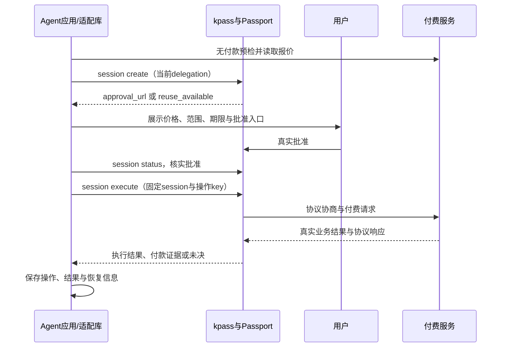
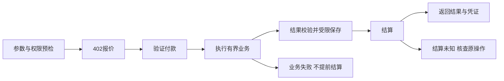

# 总体接入设计

版本 1.0 · 2026-10-18 · 设计文件。以下是工程方案与验收目标，不是已运行结果。除明确标为官方 CLI 的命令外，函数、内部接口、事件和包名都是拟实现接口。

## 先完成 G0 兼容验证

现有官方资料存在范围差异：kite-x402-services 的清单只允许 eip155:2366 / 2368；当前 Passport execute 文档列出的多链与 dev 网络范围不同，并提示 dev 是 Arc testnet only。旧服务 README 的测试命令也与当前 session 命令写法有差异。

所以“设置 KITE_NETWORK=testnet”不能直接证明当前 Passport 能支付该服务。每个涉及付款的项目，第一阶段都必须生成 compatibility.json，写明：文档 commit、CLI 版本、实际环境、服务 network/asset、facilitator 支持结果、Passport 可执行结果、真实交易/调用证据及阻塞原因。不能用换一条链的成功结果冒充原网络互通，也不能擅自把非 Kite chain 填入旧 catalog schema。

G0 顺序：固定文档与 CLI → 读取命令能力 → 无付款 HTTP 预检 → facilitator 支持检查 → 确认授权入口与实际可付网络 → 经用户批准执行小额调用 → 核对真实产物与付款证据。真实支付由后续实施阶段另行获批，本轮不执行。

如果标准 x402 客户端能付款而 Passport 不能，应分别记录“卖方协议路径通过”和“Passport 路径阻塞”。没有实时 /supported 或实际调用证据时，也不能宣称网络不受支持，只能标未验证。

## 能力与责任分配

| 能力 | 谁提供 | 本批项目怎么用 |
|---|---|---|
| 用户登录、Agent 身份、会话批准 | Passport / kpass | 通过当前支持的命令与真实用户批准接入，不自建假会话 |
| 服务发现 | ksearch 与目录 | 搜索和读取真实 example，发布自有服务还需按真实目录流程审核 |
| 付款执行 | Passport session execute | 显式方法/会话/操作 key，保留执行与付款证据 |
| 卖方付款验证与结算 | 支持的 x402 组件与 facilitator | verify → 有效同步业务结果 → settle；失败顺序按受测实现验证 |
| 任务、业务权限、产物、恢复 | 本项目应用 | 自己实现持久状态、鉴权与交付，不把钱包等同工作区权限 |
| 异步轮询与 SIWX 客户端处理 | 当前 Passport 已有文档流程 | 组件补卖方实现及恢复，不声称原生缺失 |
| A2A 在线完整状态机验证 | 待实现的独立驱动 + 真实 Runtime | 不以离线向量通过冒充在线合规 |

## 买方：发现、授权、执行、恢复



以下只展示当前官方文档中的命令形状，不是可以直接复制付款的脚本。尖括号需替换为实际值；用户身份和批准缺失时不得执行购买。

```text
kpass agent:register --type <真实宿主类型> --output json
ksearch service search <关键词>
ksearch service search --example <service-id>
kpass session create --delegation '<inner-delegation-json>' --output json
kpass session status --request-id <request-id> --output json
kpass session execute --url <merchant-url> --method POST --session-id <session-id> --body '<json>' --idempotency-key <passport-operation-key> --output json
kpass activity --kind x402_payment --output json
```

delegation 由当前 form-session-delegation 规范构建，顶层是 task、payment_policy 和可选 execution_constraints；不是自己再包一层 delegation。普通会话不要照抄旧 README 的 --assets 或旧 agent session 语法。批准等待按当前 request-session 流程实现，初始等待与用户再次确认后的单次检查区分；复用必须检查真实目标相同。不要自动执行 next_command 字符串。

session execute 显式传原 session。recurring 操作要先确认安装的 CLI 支持 --idempotency-key；它转发到 Passport，不自动等于商家业务幂等键。项目另外维护 merchant operation_id 与输入摘要，避免“同付款操作重试”和“新买一次”混淆。

参数通过进程 argv 传入，不拼 shell；真实凭证输出在解析前不得落普通日志。首次注册返回 token 时，只由官方安全存储或经过验证的凭证上下文管理，库不复制到工程文件。

## 卖方：同步服务



只有协议验证过的付款主体可用于买方绑定，不能信任客户端传来的 wallet 字段。需要另有用户上传或工作区权限时，应用也必须验证。不公开产物索款，不把长任务的“已接单”显示成“已完成”。付款成功但响应丢失时恢复原结果，不产生一笔新购买。

本地防重降低重复执行，不保证网络分区下天然实现全局恰好一次支付。签名/nonce/receipt 与业务请求的绑定按实际 SDK 验证；不能假设一笔链上转账天然证明某份文件内容。

## 异步：使用已有 Job→Poll→Retrieve 与 SIWX 路径

当前 Passport 文档已支持付费响应返回 job/pollUrl，后续同 session 轮询；SIWX 身份取件可零付款。组件 07 负责卖方 durable job、原付款人绑定、outbox、产物与恢复，先做真实互通 PoC。

异步与同步合同分开：同步接口在有效结果生成后结算；异步合同明确用户购买的任务、预计时间、实际交付义务和失败处理。付费接单响应可以是 202，但这不代表产物已完成，也不自动证明符合当前服务目录的审核要求。

poll URL 必须先相对原商家 URL 解析再检查完全同源；scheme/host/port 改变都不可偷偷沿用授权。使用原付款 session 与钱包；SIWX 是签名身份验证，不是再次付费。轮询超时记 unresolved，不能仅因超时认定任务失败和触发自动退款。不能只用“存在任意 URL”判断产物可用，本项目状态协议只把明确 result/artifact 字段作为实际输出。

## 清单与服务发布

service.yaml 需按固定 service.schema.json 校验。重要字段：schema=1、name、display_name、description、maintainer.github、status、network、pay_to、upstream、endpoints、categories。base_url 在非 draft 时必填，必须是公共 HTTPS origin。自研服务/组件来源填 custom；不要向闭合 schema 添加 job_id、trace_id 等私有字段，扩展信息留在应用内部协议。

每个 endpoint 写 method、/v1/* path、summary、price_usd 与真实 example_request；价格用字符串，最多六位小数，token 单位按真实资产 decimals 转换。目录旧 schema 只收 Kite chain 网络，不能把其他网络强行填入。

未部署/未付款保留 draft。testnet/live 必须有对应环境的真实部署与调用证据，主网 live 不能拿 dev 或模拟结果代替。独立工具 02–06 不为贴标签而人为套一层收费 API；具体赛道与 tooling 提交范围分别核对。

## 三类验收必须分开

- 产品完成：业务功能、失败处理、权限、产物真实可用。
- Kite 互通：固定环境下真实身份、批准、付款/协议与交付均可核对。
- 外部认可：服务目录、活动审核、EC 映射和活跃开发者统计各自独立。

这些方案不保证奖励、EC 收录或活跃统计。首批开发宜三选二：01 .NET、03 对账、08 浏览器；最终以真实用户和兼容验证决定。
